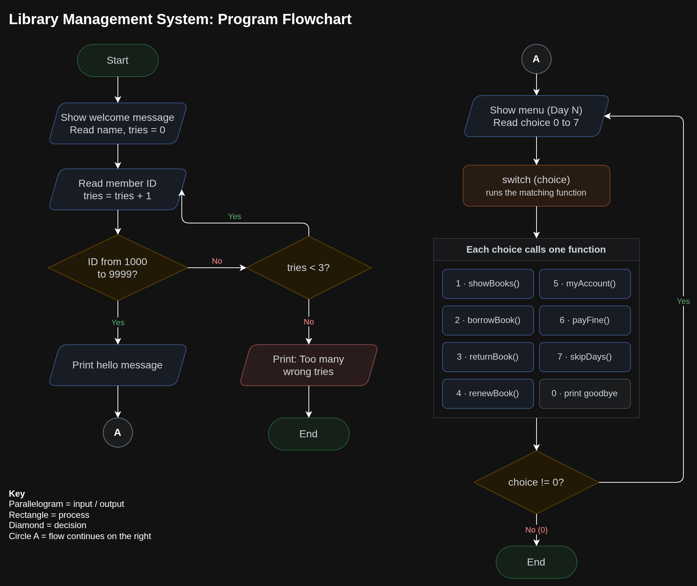
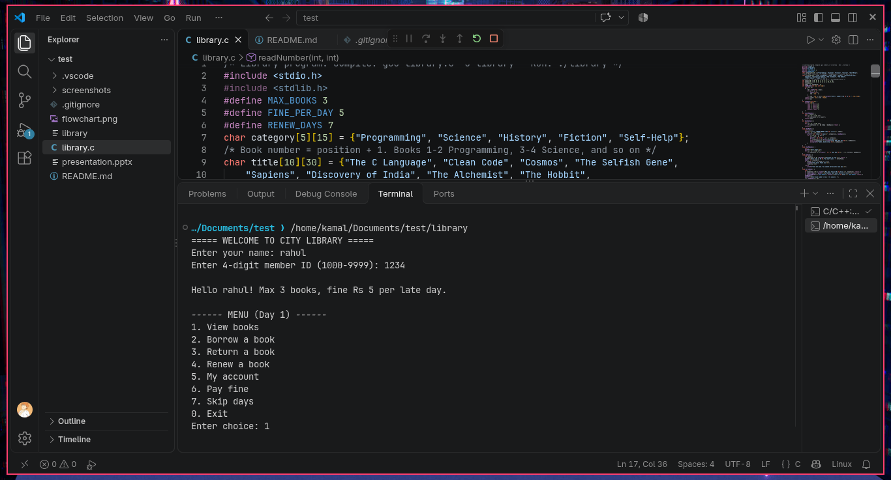
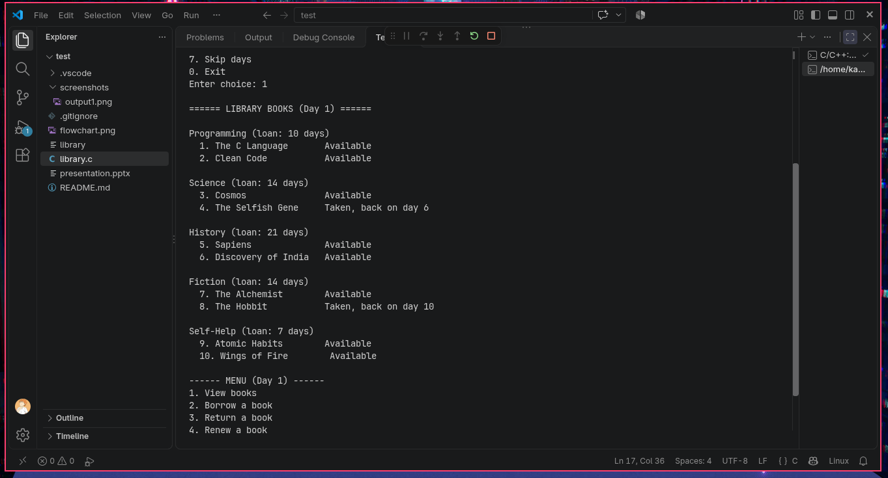
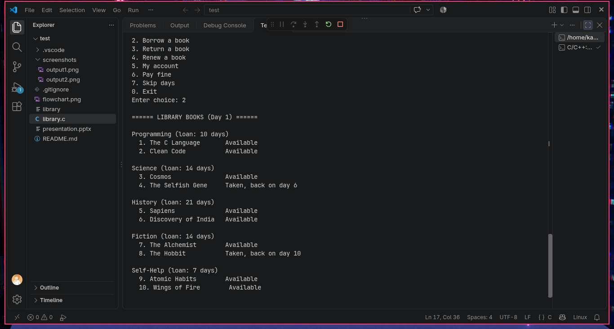
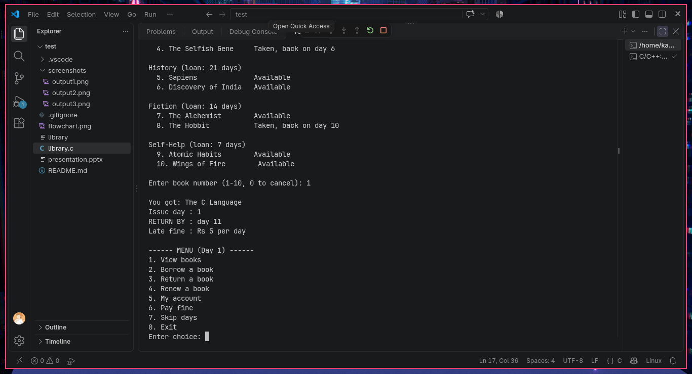
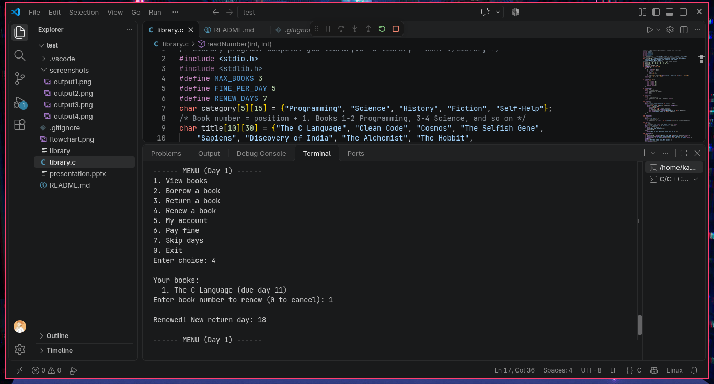

# Library Management System

**C Programming Lab: Mini Hackathon | Problem 2: Library Book Management System**

## Team Details

| Field | Details |
|---|---|
| Batch | 50 |
| Team Name | Dhoor |
| Member 1 | Aachitya |
| Member 2 | Kamal |
| Member 3 | Anwit |

## Problem Statement

A library needs a simple program to keep track of its books: which books are available, who has them, and when they are due. We built a menu-driven C program that lets a member view books, borrow, return and renew them, and pay late fines.

## Objectives

- Store the details of 10 books (title, category, status, due day) using arrays.
- Let a member borrow and return books with proper checks.
- Calculate the due date from the book category and the late fine for overdue books.
- Check every input so that wrong input does not break the program.

## Features

- **Member login:** name and a 4-digit member ID (1000 to 9999), with 3 tries.
- **View books:** 10 books in 5 categories, with status: Available, With YOU, or Taken (with the return day).
- **Borrow:** maximum 3 books at a time. Blocked if there is an unpaid fine or a late book.
- **Different loan period by category:** Programming 10 days, Science 14, History 21, Fiction 14, Self-Help 7.
- **Return:** checks if the book is late and adds a fine of Rs 5 per late day.
- **Renew:** only once per book, adds 7 days, not allowed if the book is already late.
- **My account:** shows days left for each book, DUE TODAY, or LATE with the fine.
- **Pay fine:** the member must pay the fine before borrowing again.
- **Skip days:** moves the library date forward so that late returns can be tested without waiting.

## How the Program Works (Algorithm)

```
1. Show welcome message, read member name
2. Repeat up to 3 times: read member ID
      if ID is not between 1000 and 9999 -> print "Wrong ID!"
   if still wrong after 3 tries -> print message and stop
3. Repeat until the user enters 0:
      show menu and read choice (0 to 7)
      switch (choice):
         1 -> showBooks()      5 -> myAccount()
         2 -> borrowBook()     6 -> payFine()
         3 -> returnBook()     7 -> skipDays()
         4 -> renewBook()      0 -> print goodbye
4. End
```

**borrowBook() checks, in this order:** unpaid fine, late book, limit of 3 books, then the selected book (already with me / taken by someone else / available). If the book is available: `status = 1`, `dueDay = today + loanDays(category)`.

**returnBook():** `late = today - dueDay`. If `late > 0` then `fine = late * 5` is added to `totalFine` and `payFine()` is called.

## Flowchart



## Data Storage

| Variable | Type | Purpose |
|---|---|---|
| `category[5][15]` | 2D char array | Names of the 5 categories |
| `title[10][30]` | 2D char array | Titles of the 10 books |
| `status[10]` | int array | 0 = in library, 1 = with me, 2 = with another person |
| `dueDay[10]` | int array | Day on which the book is due |
| `renewed[10]` | int array | 1 if the book was already renewed |
| `today`, `totalFine` | int | Current library day and fine to pay |

The same index in every array belongs to the same book. Book number = index + 1. The category of a book is `index / 2`.

## Functions

| Function | Job |
|---|---|
| `readNumber(low, high)` | Reads a number and asks again until it is in range (also handles letters) |
| `loanDays(cat)` | Returns loan days for a category using `switch` |
| `countMyBooks()` | Counts books with status 1 |
| `hasOverdue()` | Returns 1 if any of my books is late |
| `showBooks()` | Prints all books by category |
| `showMyBooks()` | Prints only my books |
| `borrowBook()` | Issues a book after the checks |
| `returnBook()` | Returns a book and calculates the fine |
| `renewBook()` | Adds 7 days, only once per book |
| `myAccount()` | Shows days left, late books and fine |
| `payFine()` | Asks the member to pay the fine |
| `skipDays()` | Moves the date forward by 1 to 60 days |

## C Concepts Used

- `#define` constants (`MAX_BOOKS`, `FINE_PER_DAY`, `RENEW_DAYS`)
- 1D and 2D arrays (strings stored as char arrays)
- Functions (12 functions plus `main`)
- Loops: `for`, `do-while`
- Decision making: `if / else if / else`, `switch`
- Operators: arithmetic, relational (`>`, `==`) and logical (`&&`, `||`)
- Input validation using the return value of `scanf` and range checks
- Global variables

## How to Compile and Run

Needs a C compiler such as GCC.

```bash
gcc library.c -o library
./library
```

On Windows (MinGW), run `library.exe` instead of `./library`.

## Sample Test Cases

All outputs below are from real runs of the program.

| # | Test | Input | Expected | Actual output |
|---|---|---|---|---|
| 1 | Borrow a book | Menu 2, book 1 (day 1) | Book issued for 10 days | `You got: The C Language`, `RETURN BY : day 11` |
| 2 | Borrow limit | Borrow 3 books, then try a 4th | Blocked | `Limit is 3 books.` |
| 3 | Taken book | Menu 2, book 4 | Not issued | `Someone else has it. Back on day 6.` |
| 4 | Invalid menu input | Type `abc` at the menu | Asks again | `Enter a number from 0 to 7:` |
| 5 | Wrong member ID | 3 wrong IDs | Program stops | `Wrong ID!` (3 times), then `Too many wrong tries. Goodbye.` |
| 6 | Late return | Borrow book 1, skip to day 15, return it | Fine = 4 days x Rs 5 | `4 day(s) late. Fine = Rs 20` |
| 7 | Borrow with unpaid fine | Do not pay the fine, then borrow | Blocked | `Fine not paid. You cannot borrow until you pay.`, then `Pay your fine of Rs 20 first.` |
| 8 | Renew a book | Renew book 1 once | 7 more days | `Renewed! New return day: 18` |
| 9 | Renew twice | Renew the same book again | Not allowed | `You can renew a book only one time.` |

## Screenshots

Screenshots of the program running:

## Screenshots











## Repository Contents

```
library.c            source code
README.md            this file
presentation.pptx    presentation for Lab 2
flowchart.png        flowchart of the program
screenshots/         output screenshots
```
